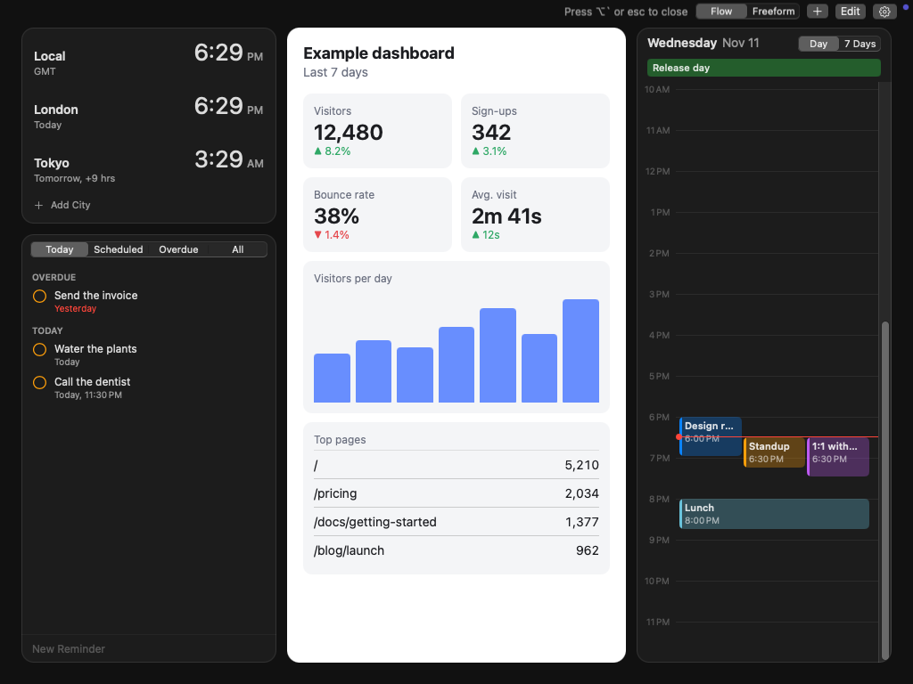

# Gander

**Hold a key to glance at the things you check all day. Let go and you are back where you were.**

Gander is a free, open-source macOS menu bar app. It keeps websites, local files and small widgets
loaded in a full-screen overlay that appears while you hold a shortcut — over any app, including
full-screen ones — and disappears when you release it.

- **Hold** the shortcut (default `⌥` + `` ` ``) to peek. Release to return.
- **Tap** the shortcut to keep the overlay open and use it. Tap again or press `esc` to close.



## What it does

| | |
|---|---|
| **Websites** | Any site, in WebKit. Logins persist. Back/forward/reload, zoom, mobile-site mode, auto-refresh. |
| **Local files** | PDF and HTML. Add from the launcher or Finder's *Open With → Gander*. Reloads when the file changes. |
| **Widgets** | Clock (multiple time zones), Calendar (day timeline or next 7 days), Reminders (today / scheduled / overdue / all, tick off, add), Notes. |
| **Less noise** | Blocks third-party ads and trackers, hides cookie banners, and lets you click page elements to hide them for good. Accepts your own Adblock Plus-style filters. |
| **Layouts** | *Flow* packs tiles into columns for you; *Freeform* lets you drag and resize anywhere with snapping. |
| **Displays** | Opens on the display with the pointer, the active window, or one you pick. One layout everywhere, or one per display. |
| **Shortcut** | Any key combination, or modifier keys alone — including a specific left or right one (`Right ⌘`, `fn`). |
| **Hand off** | Open any tile in your browser or its default app from its `…` menu. |

Your layouts and browsing data stay on your Mac. Gander has no account, analytics or server.

## Install

Requires macOS 14 or later.

**Build from source** (needs Xcode 16 or its command line tools):

```bash
git clone https://github.com/Michaell14/peek.git gander
```

```bash
cd gander && make install
```

That builds `build/Gander.app` and copies it to `/Applications`. Use `make run` to build and launch
without installing.

**Download a build:** every push builds the app in CI; download the `Gander` artifact from the
latest run under the repository's *Actions* tab. Builds are signed ad hoc, not notarized, so macOS
will refuse to open a downloaded copy until you clear the quarantine flag:

```bash
xattr -dr com.apple.quarantine /Applications/Gander.app
```

## Using it

Gander lives in the menu bar (the eye icon) and has no Dock icon. On first launch it opens with a
starter layout.

With the overlay open (tap the shortcut), the controls are in the top-right corner:

| | |
|---|---|
| `+` or `⌘N` | Add a website, file or widget |
| **Edit** or `⌘E` | Move, resize and remove tiles |
| **Flow / Freeform** | Switch layout mode; tiles stay where they are |
| Hover a tile | Back, forward, reload and a `…` menu with everything else |
| `⌘R` `⌘[` `⌘]` | Reload / back / forward for the web tile under the pointer |
| `⌘`-click a link | Open it in your browser instead |
| `esc` | Back out one step, then close |

To hide part of a page, choose **Hide Elements…** from a web tile's `…` menu and click what you
want gone. `↑` widens the selection to the surrounding element and `↓` narrows it again. Choices
are remembered per site; **Show Hidden Elements** brings them back.

### Permissions

Gander asks only for what a feature needs, and only when you use it.

| Permission | Needed for |
|---|---|
| Calendars / Reminders | Those two widgets |
| Input Monitoring | Only shortcuts made of modifier keys alone or a specific left/right key. Ordinary shortcuts need nothing. Gander looks for the shortcut and does not record what you type. |

When built from source, the app is signed ad hoc. macOS ties permissions to the signature, so it
will ask again after each rebuild.

If you use `fn` as the shortcut, set *System Settings → Keyboard → Press 🌐 key to* **Do Nothing**,
or macOS will also run its own action.

## How it is built

```
Sources/
  GanderCore/   Models, layout, shortcut logic, content-blocking rules. Plain
                Foundation; builds and is tested on Linux as well as macOS.
  Gander/       The app: AppKit overlay and tiles, WebKit, SwiftUI widgets
                and settings.
  gander-scripts/  Dev tool that prints the JavaScript injected into pages.
Tests/
  GanderCoreTests/  Unit tests for the core.
  Browser/          Runs the injected JavaScript in a real browser.
```

A few decisions worth knowing about:

- **The overlay is a non-activating panel.** Showing it never makes Gander the frontmost app, so
  the app, space and text field you were in stay exactly as they were.
- **Tiles stay loaded while hidden.** That is what makes a peek instant, and why auto-refresh can
  keep pages current in the background. Audio never starts without a click.
- **Hover is sampled, not event-driven.** Because Gander is never frontmost, the system does not
  reliably tell its window when the pointer moves, so the overlay checks where the pointer is a
  few times a second while it is open.
- **Ordinary shortcuts use the system hot-key service**, which needs no permission. Only shortcuts
  it cannot express fall back to watching keyboard events.
- **Blocking is third-party only.** A tracker is blocked on other sites, but its own dashboard
  still works when you open it as a tile.
- **Saved data is never thrown away.** An unreadable layout file is set aside rather than
  overwritten, and tiles from a newer version are skipped without losing the rest.

### Development

```bash
make test
```

```bash
make test-browser
```

```bash
make check
```

`make test` runs the core's unit tests. `make test-browser` runs the JavaScript that Gander
injects into pages in a real browser (needs Node and Playwright).

`make check` launches the built app with a throwaway layout and has it check itself, using
simulated clicks, drags and key presses: showing and hiding, hold and tap, moving, resizing and
reordering tiles, typing into a page, content blocking and element hiding inside a real page, file
tiles, widgets and per-display layouts. It takes over the screen and the pointer for about a
minute, and writes a report and screenshots to `build/self-check`.

CI runs all three on every push.

Other switches: `--show` opens the overlay at launch; `--data-dir <path>` (or `GANDER_DATA_DIR`)
keeps layouts somewhere other than `~/Library/Application Support/Gander`.

## Not there yet

- Passkeys in web tiles. macOS only offers them to apps holding a browser entitlement that Apple
  grants case by case.
- Browser extensions.
- Showing other apps' windows as tiles.
- A stocks widget.
- Notarized builds and automatic updates.
- Sign-in flows that depend on a pop-up window talking back to the page that opened it; links that
  ask for a new window open in the same tile.

## Origin

Gander was written from scratch as an open alternative to [Peek](https://peek.zone), a commercial
app with the same hold-to-glance idea, working only from its public description. It shares no
code, assets or name with it, and is not affiliated with its makers.

## License

[MIT](LICENSE)
